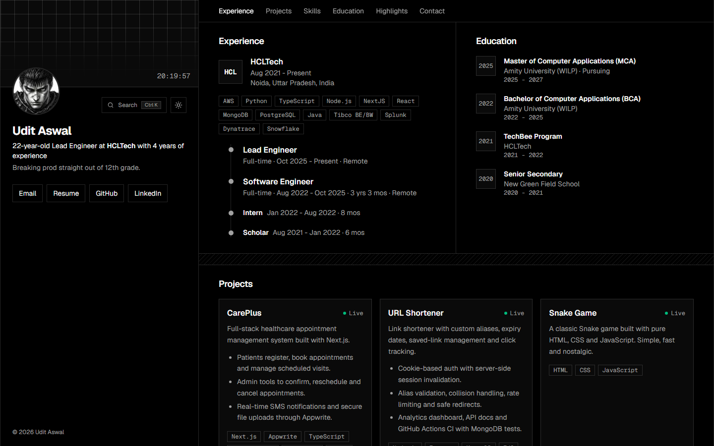

# Portfolio Website

<p align="center">
  <a href="https://portfolio-uditaswal.vercel.app/">
    
  </a>
</p>

<p align="center">
  <strong>Live site:</strong>
  <a href="https://portfolio-uditaswal.vercel.app/">portfolio-uditaswal.vercel.app</a>
</p>

## Overview

A single-page portfolio built with Next.js. On wide screens a fixed profile panel sits beside a scrolling column of experience, projects, skills, education and scrolling certificate rows. On phones everything stacks into one column. It has dark and light themes and a command palette.

## Highlights

- Responsive, mobile-friendly layout
- Section-based navigation
- Smooth animated transitions
- Reusable React components
- Downloadable resume call to action
- Dark and light themes, plus a command palette (Ctrl/Cmd + K)
- Email and social links
- Optimized local images and assets

## Editing content

Nearly everything on the site is data in [`src/app/data.ts`](src/app/data.ts). Components only display it.

| To change                  | Edit in `data.ts`                | Also needed                                                      |
| -------------------------- | ---------------------------------- | ---------------------------------------------------------------- |
| Name, role, email, links   | `profile`                        |                                                                  |
| Add a project              | copy an object in `projects`     |                                                                  |
| Add a job or role          | `experience` (newest role first) |                                                                  |
| Add a skill chip           | `skills`                         | icon file in `public/logo`                                     |
| Add a certificate or honor | `certificates` / `honors`      | image in `public/certificates`                                 |
| Add or reorder a section   | `sections`                       | add the component in `src/app/page.tsx` with a matching `id` |
| Avatar                     |                                    | replace `public/berserk.jpg`                                   |

## Built with

- Next.js 15
- React 19
- TypeScript
- Tailwind CSS
- Framer Motion

## Run locally

### Prerequisites

- Node.js 20 or newer
- npm

### Setup

```bash
git clone https://github.com/uditaswal/Portfolio.git
cd Portfolio
npm install
npm run dev
```

Open [http://localhost:3000](http://localhost:3000) in your browser.

## Available scripts

```bash
npm run dev    # Start the development server
npm run build  # Create a production build
npm run start  # Run the production server
```
